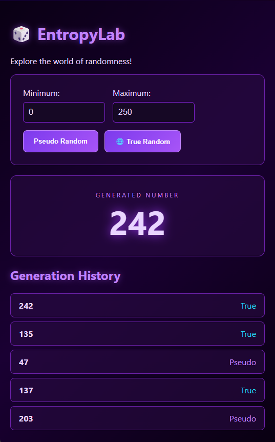

# 🎲 EntropyLab

A cross-platform random number generator built with **.NET MAUI, Angular, and C#**, featuring a cyberpunk-inspired interface.

### ✨ Features
- 🔢 **Pseudo Random** — Cryptographically secure generation using C#.
- 🌐 **True Random** — Real-world randomness via RANDOM.ORG.
- 🎯 Customizable minimum and maximum values.
- 📜 History of the last 10 results, labeled by source.
- 💜 Responsive cyberpunk-themed UI.

### 🛠️ Tech Stack
- **Backend:** .NET MAUI 9 / C#
- **Frontend:** Angular 22 / TypeScript / HTML / CSS
- **Communication:** HybridWebView
- **External API:** RANDOM.ORG

### 🚀 How to Run
1. Clone the repository.
2. Install Angular dependencies using `npm install` inside `entropylab-web`.
3. Run `sync-web.cmd` to build and synchronize Angular.
4. Open the solution in Visual Studio 2022 and run it on Windows or Android.

### 👨‍💻 Author
**Victorio Moraru**

### 📸 Screenshots

  

